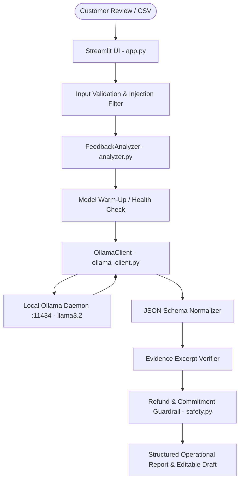

# ⚡ FeedbackOps AI

**FeedbackOps AI** is an intelligent, privacy-first customer feedback operations and pain point triage application built with **Python**, **Streamlit**, and **Local Ollama LLMs**.

It transforms raw, unstructured customer reviews, support tickets, and NPS comments into structured, evidence-grounded operational intelligence—identifying sentiment, ranking urgency, isolating verified pain points, recommending internal team actions, and drafting personalized customer responses without requiring paid cloud API keys or exposing customer data.

---

## ✨ Features

- **🔒 100% Private & Zero-Cost Inference**: Powered by local Ollama models (`llama3.2`, `mistral`, `phi3`). Customer feedback never leaves your local machine.
- **🛡️ Refund Safety & Commitment Guardrails**: Deterministic safety interceptor prevents AI hallucination of unauthorized refund promises, unapproved compensation, or invented deadlines (e.g. "refund within 24 hours").
- **🎯 Evidence-Based Grounding**: Every extracted pain point must include a verbatim quote excerpt from the customer's text, verified against the source before being flagged.
- **🛡️ Prompt Injection Neutralization**: Treats raw customer feedback strictly as untrusted passive data, neutralizing adversarial instructions embedded inside reviews.
- **⏱️ Configurable Generation Timeout**: Defaults to **180 seconds** with UI controls in the sidebar to support larger models without read timeouts.
- **🔥 Lightweight Model Warm-Up**: Executes a fast health check ping to ensure the model is loaded in memory before heavy generation tasks.
- **📊 Robust Batch CSV Triage**: Analyzes entire feedback datasets with live progress tracking, sentiment breakdown charts, urgency distribution, and explicit percentage denominators.
- **📥 One-Click Export**: Export complete operational analysis reports as structured **CSV** or **JSON**.
- **📁 Preset Sample Dataset**: Clearly labeled synthetic test reviews covering E-Commerce, SaaS, and Mobile App scenarios for instant demonstration.
- **🧪 100% Passing Automated Tests**: 31 comprehensive unit and live integration tests covering safety, validation, batch metrics, and real Ollama inference.

---

## 🛠️ System Architecture



### Module Overview

- `app.py`: Streamlit dashboard with 4 tabs (Single Review, Batch CSV, Sample Library, Diagnostics).
- `feedbackops/safety.py`: Deterministic guardrail intercepting unapproved refunds, invented deadlines, and verifying quote grounding.
- `feedbackops/analyzer.py`: Prompt engineering, schema normalization, and orchestrator.
- `feedbackops/ollama_client.py`: Local REST API client for Ollama with configurable timeouts and warm-up checks.
- `feedbackops/utils.py`: CSV validation, explicit denominator metrics, and export helpers.
- `feedbackops/sample_data.py`: Clearly labeled synthetic sample dataset.

---

## 🚀 Local Installation & Launch Guide (Windows)

Follow these step-by-step instructions to set up and run FeedbackOps AI on Windows.

### Step 1: Prerequisites
- **Python 3.10 or higher** installed on Windows.
- **Ollama for Windows** downloaded and installed from [ollama.com/download](https://ollama.com/download).

### Step 2: Clone or Open Directory
Open Windows PowerShell and navigate to the project directory:
```powershell
cd c:\Users\Madhavi\Downloads\feedbackops-ai
```

### Step 3: Install Python Dependencies
Install required packages using pip:
```powershell
python -m pip install -r requirements.txt
```

### Step 4: Download Local Ollama Model
Ensure the Ollama application is running, then pull the default model (`llama3.2`):
```powershell
ollama pull llama3.2
```

### Step 5: Launch Streamlit Application
Run the Streamlit application:
```powershell
python -m streamlit run app.py
```
The application will open in your default browser at `http://localhost:8501`.

---

## 🧪 Automated Testing

Execute `pytest` to run the test suite, including mocked safety tests and live Ollama inference:

```powershell
python -m pytest -v
```

### Verified Test Results:
```
============================= test session starts =============================
platform win32 -- Python 3.11.0, pytest-9.1.1, pluggy-1.6.0
collected 31 items

tests/test_analyzer.py::test_analyzer_input_validation PASSED            [  3%]
tests/test_analyzer.py::test_analyze_review_success PASSED               [  6%]
tests/test_analyzer.py::test_evidence_grounding_verification PASSED      [  9%]
tests/test_analyzer.py::test_unauthorized_refund_sanitized_in_analyzer PASSED [ 12%]
tests/test_analyzer.py::test_prompt_injection_flagged_in_analyzer PASSED [ 16%]
tests/test_analyzer.py::test_schema_normalization_defaults PASSED        [ 19%]
tests/test_analyzer.py::test_analyze_batch PASSED                        [ 22%]
tests/test_analyzer.py::test_analyze_review_timeout_exception PASSED     [ 25%]
tests/test_live_ollama.py::test_live_ollama_real_inference PASSED        [ 29%]
tests/test_ollama_client.py::test_client_configurable_timeout PASSED     [ 32%]
tests/test_ollama_client.py::test_check_connection_success PASSED        [ 35%]
tests/test_ollama_client.py::test_check_connection_failure PASSED        [ 38%]
tests/test_ollama_client.py::test_list_models_success PASSED             [ 41%]
tests/test_ollama_client.py::test_is_model_available PASSED              [ 45%]
tests/test_ollama_client.py::test_generate_json_success PASSED           [ 48%]
tests/test_ollama_client.py::test_generate_json_timeout_handling PASSED  [ 51%]
tests/test_ollama_client.py::test_generate_json_codeblock_parsing PASSED [ 54%]
tests/test_ollama_client.py::test_generate_json_model_not_found PASSED   [ 58%]
tests/test_ollama_client.py::test_warmup_model PASSED                    [ 61%]
tests/test_safety.py::test_detect_unauthorized_refund_promises PASSED    [ 64%]
tests/test_safety.py::test_detect_invented_deadlines PASSED              [ 67%]
tests/test_safety.py::test_detect_unauthorized_compensation PASSED       [ 70%]
tests/test_safety.py::test_sanitize_draft_response_replaces_unsafe_content PASSED [ 74%]
tests/test_safety.py::test_sanitize_draft_response_preserves_safe_content PASSED [ 77%]
tests/test_safety.py::test_verify_evidence_excerpt PASSED                [ 80%]
tests/test_safety.py::test_sanitize_action_item PASSED                   [ 83%]
tests/test_safety.py::test_detect_prompt_injection PASSED                [ 87%]
tests/test_utils.py::test_validate_text_input PASSED                     [ 90%]
tests/test_utils.py::test_validate_csv_dataframe PASSED                  [ 93%]
tests/test_utils.py::test_compute_aggregate_metrics_with_explicit_denominators PASSED [ 96%]
tests/test_utils.py::test_export_results_to_csv_and_json PASSED          [100%]

============================= 31 passed in 38.01s =============================
```

---

## 🌐 Deployment Options (Strict ₹0 Budget Analysis)

| Option | Architecture | Feasibility | Cost | Trade-offs & Reality |
| :--- | :--- | :--- | :--- | :--- |
| **Option 1: Local Execution + Video Demo (Recommended)** | Runs on Windows PC via Ollama | **100% Feasible & Tested** | **₹0** | Fastest inference, zero API fees, full hardware utilization, zero network latency. Ideal for portfolio videos and GitHub repositories. |
| **Option 2: Streamlit Community Cloud (Hosted UI)** | App hosted on Streamlit Cloud | **UI Only** | **₹0** | Streamlit Cloud runs on remote Linux containers where `localhost:11434` cannot reach your PC. Shows the offline setup banner unless tunneled via Cloudflare/ngrok. |
| **Option 3: Free Cloud Tunneling** | Streamlit Cloud + Cloudflare Tunnel to PC | **Partially Feasible** | **₹0** | Exposes local Ollama via tunnel. Requires keeping your PC turned on and active. Not recommended due to security and sleep states. |

**Recommended Portfolio Approach**:
Host the source code and documentation on GitHub, present verified local test outputs, and record a 60–90 second clean video walkthrough of the running application for LinkedIn.

---

## 🔒 Security & Privacy Review

- **Zero Hardcoded Secrets**: Scanned and verified. No API keys, passwords, or tokens in source.
- **Zero Customer Data Committed**: All sample datasets (`SAMPLE_REVIEWS` and `sample_reviews.csv`) are 100% synthetic.
- **Untrusted Input Sanitization**: Customer reviews are treated strictly as untrusted text within bounded tags to resist prompt injection.
- **Human-in-the-Loop**: Generated customer responses and operational recommendations are explicitly marked as advisory drafts requiring human staff authorization before execution.

---

## 📄 License

MIT License. Free to use for personal, educational, and commercial portfolio projects.
